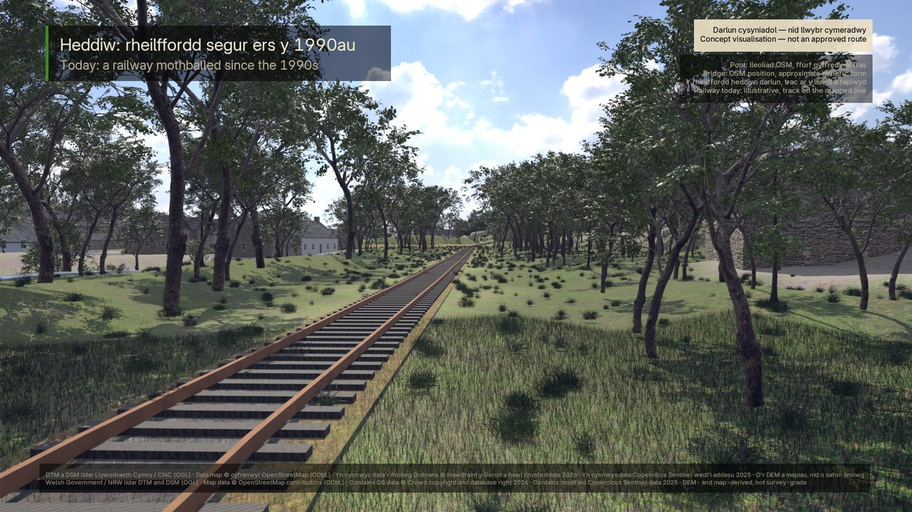
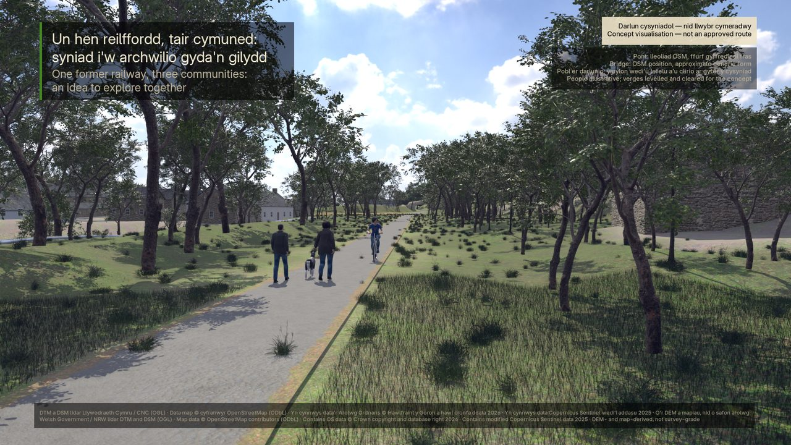
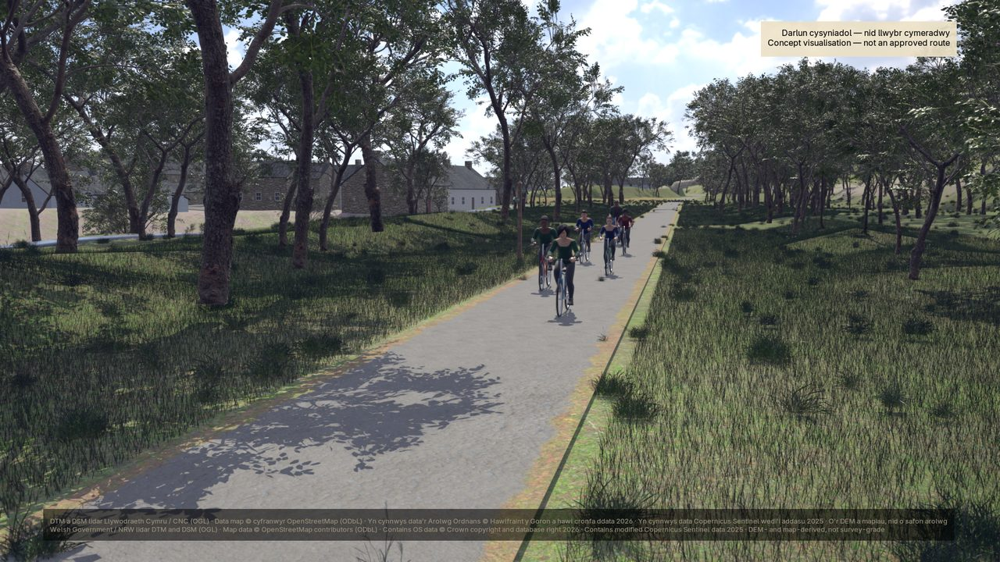
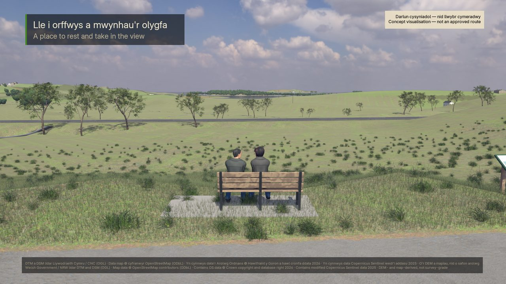
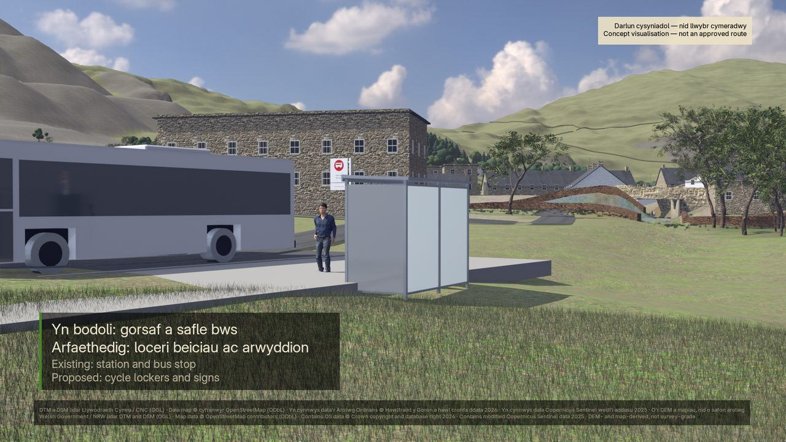
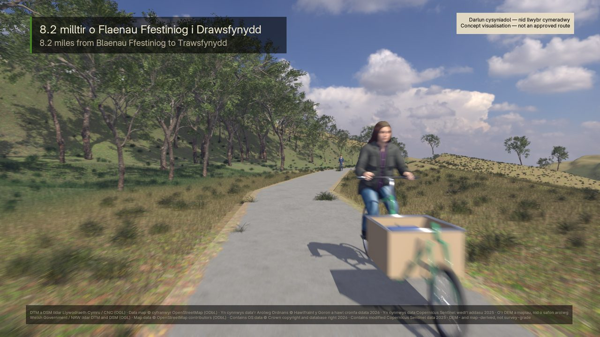

# Llwybr Blaenau Ffestiniog – Trawsfynydd · a cycling and walking route concept

**Cysyniad cymunedol yw hwn, nid cynllun cymeradwy.** This is a community concept, not an approved scheme.

An animated, bilingual (Welsh first) visualisation of what a walking and cycling route along the mothballed Bala and
Festiniog Railway corridor between Blaenau Ffestiniog and Trawsfynydd could look like: 8.2 miles through
Llan Ffestiniog, past Maentwrog Road and the Trawsfynydd lake. It exists to help a conversation, not to settle one.

> The corridor is a mothballed, Network Rail-protected railway with a history of heritage-railway proposals. Nothing
> here is an engineering design, a route approval, a planning application or a statement about land ownership.
> Every proposed or approximate feature carries an on-screen label saying so, and the terrain and features come from
> open lidar, OpenStreetMap and satellite data, not from survey. `docs/research.md` sets out what is verified, what is
> proposed and what is unknown.

| | |
|---|---|
|  |  |
|  |  |
|  |  |

*Frames from the three-minute community film (Blender, EEVEE). The railway "today" is illustrative: track on the mapped
line, not a survey of its condition.*

## What is here

| Piece | What it is | Where |
|---|---|---|
| `CyclingVision` | The original 2D route video: a stylised map journey over an OpenTopoMap basemap with the elevation profile and captions | `src/CyclingVision.tsx`, `src/scenes/`, `src/components/` |
| `Reel3D` and `Section-<id>` | A 1:30 Three.js reel of nine sections on real lidar terrain, with trees sized from the canopy model, OSM walls and buildings, and a Sentinel-2 image on the aerials | `src/three-core/`, `src/three/`, `src/data/reel-*.ts` |
| The community film | A three-minute Blender film of the route in use (school run, families, neighbours, the station, a place to rest, the ride), with a soundtrack and Welsh-over-English captions | `src/data/community-film.ts`, `scripts/blender/`, `scripts/film/` |
| The social cuts | Five short vertical, square and landscape cuts of the film with SRT subtitles and post text | `src/social/`, `src/data/social-cuts.ts`, `scripts/social/` |
| The data pipeline | Fetches and processes the open data: lidar DTM and DSM, OSM, OS OpenMap Local buildings, Sentinel-2, DataMapWales records | `scripts/*.py`, `scripts/dem/`, `scripts/osm/`, outputs in `data/` and `public/data/` |
| Documentation | Research, storyboard, specification, design, 63 architecture decision records, validation logs | `docs/`, index of decisions in `docs/adr/README.md` |

## Requirements

| Need | For |
|---|---|
| Node.js 24 (20.19 or 22.13 also work) and npm | Everything: `npm ci` installs the pinned dependencies without running install scripts |
| Python 3.12 or later with `numpy` and `pillow` (`scipy` for the soundtrack scripts) | The data pipeline, the pipeline self-tests in `npm test`, the still metrics and the audio |
| ffmpeg and ffprobe on `PATH` | Encoding the film and the checks on rendered video |
| A GPU | The 3D renders and render checks run on the CPU but take far longer |
| Blender 5.2 with the MPFB 2.0.18 add-on, and about 800 MB of CC0 assets fetched by `npm run blender:assets` | The community film and the social cuts only |

Nothing needs an account, a key or a private service. The pipeline reads public endpoints (DataMapWales, the
OpenStreetMap API, the OS Downloads API, AWS open data) with an identifying User-Agent; the processed results are
already in the repository, so the videos render without re-fetching anything.

## Quick start

```console
npm ci
npm run dev
```

Remotion Studio opens with the compositions `CyclingVision`, `Reel3D`, `Section-intro` … `Section-closing`,
`Poc3DMaentwrog` and `Poc3DMaentwrogPhoto`. Then:

| Task | Command |
|---|---|
| Lint and type-check | `npm run lint` |
| Tests (unit, static, documentation and real-data acceptance) | `npm test` |
| Render checks before changing anything that affects pixels (10–30 min, GPU, ffmpeg) | `npm run test:render` |
| Render the 2D video | `npx remotion render src/index.ts CyclingVision out/trawsfynydd-cycle-vision.mp4` |
| Render the 3D reel | `npm run render:reel` (passes `--gl=angle`; never set the GL renderer in `remotion.config.ts`) |
| One frame of the reel | `npm run still:reel -- --frame=<n>` |
| Rebuild one section's data from the open sources | `npm run data:section -- <window>` then `npm run data:sync` |
| The community film | `npm run blender:assets`, `npm run blender:export -- community`, `npm run blender:reel -- --dressed --film community --samples 32`, then render with `scripts/blender/render_film.py` and `npm run film:audio` and `npm run film:encode` |
| The social cuts | `npm run social:plates`, `npm run social:audio`, `npm run social:render`, `npm run social:qa` |

The step-by-step operating procedure, with what each check proves, is `docs/sop-3d.md`; the Blender pipeline is
`docs/design-blender.md`; the film's direction, grade and shot list are `docs/film-enhancement-2026-11.md`.

## Honesty rules the code enforces

- The route is drawn from OpenStreetMap's mapped alignment and the terrain from 1 m lidar; neither is survey-grade.
- Proposed features (the path, benches, lockers, signs) are labelled "proposed" and "concept only" on screen; the
  existing station, bus stop and buildings are labelled "existing". A test fails if a labelled feature loses its label.
- Captions are Welsh first, then English, with miles and mph on screen.
- 3D renders are deterministic: no clocks, timers or unseeded randomness (a static test checks the source).
- `data/source-register.md` records where every figure came from and what is still unverified.

## Data and licences

The code, the documentation and the project's own renders are under the MIT licence in `LICENSE` (frames of the 2D
video include OpenTopoMap tiles, so shared renders of it carry the tiles' CC BY-SA terms as well). The open data and
assets the repository redistributes stay under their own licences, listed with their required attributions in
[`THIRD_PARTY_NOTICES.md`](THIRD_PARTY_NOTICES.md): OpenStreetMap (ODbL), OpenTopoMap tiles (CC BY-SA), Welsh
Government and Natural Resources Wales lidar, OS OpenMap Local and DataMapWales records (Open Government Licence
v3.0), Copernicus Sentinel-2 (Sentinel data legal notice), Open-Meteo elevations (CC BY 4.0), Poly Haven and MakeHuman
assets (CC0), the Inter font (OFL). Remotion itself is source-available and needs a company licence above three
employees; see its [terms](https://github.com/remotion-dev/remotion/blob/main/LICENSE.md).

## Contributing and security

Contributions are welcome: see [`CONTRIBUTING.md`](CONTRIBUTING.md). Please report security problems privately as
described in [`SECURITY.md`](SECURITY.md). Guidance for AI coding agents is in [`AGENTS.md`](AGENTS.md).
